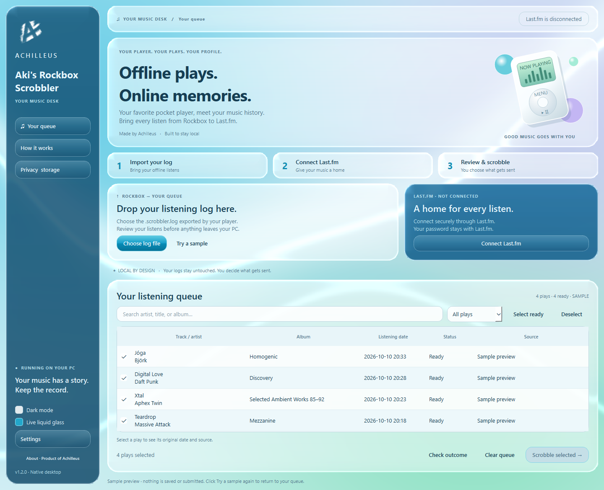
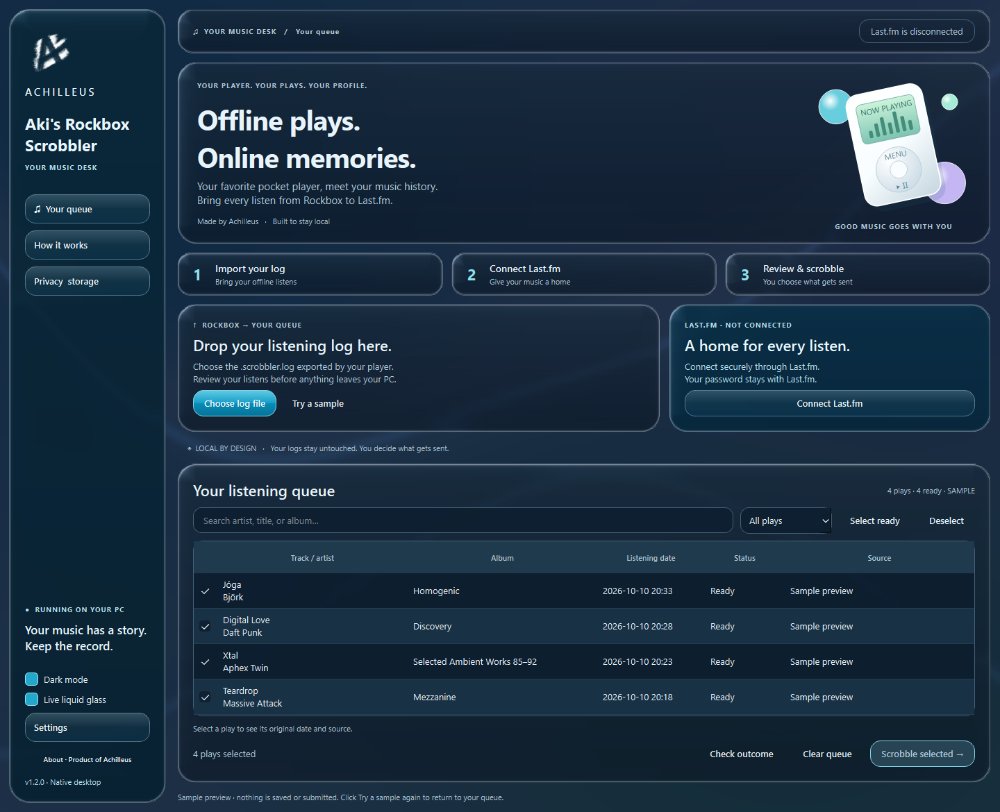

# Aki's Rockbox Scrobbler

**[Product of Achilleus](https://linktr.ee/achilleus_)** | Created and maintained by [Achilleus](https://github.com/Achilleus-1).

Your pocket player's listening history, on Last.fm. A standalone Windows EXE for importing Rockbox logs, reviewing plays, and scrobbling the ones you choose. Frutiger Aero scenery, rounded glass cards, genuine animated liquid glass, and remembered dark mode.

[](https://github.com/Achilleus-1/Akis-Rockbox-Scrobbler/actions/workflows/checks.yml)
[](https://github.com/Achilleus-1/Akis-Rockbox-Scrobbler/releases/latest)
[](LICENSE)



**[Download for Windows](https://github.com/Achilleus-1/Akis-Rockbox-Scrobbler/releases/latest)** | [User guide](docs/USER_GUIDE.md) | [Troubleshooting](docs/TROUBLESHOOTING.md) | [Changelog](CHANGELOG.md)

## Install on Windows

Windows 10/11 x64 is supported. Open [Releases](https://github.com/Achilleus-1/Akis-Rockbox-Scrobbler/releases/latest) and choose:

| Download | Use it for |
| --- | --- |
| `Akis-Rockbox-Scrobbler-1.2.0-windows-x64-setup.exe` | Recommended: install, then launch the app's EXE from the Start menu or desktop shortcut. Includes Windows uninstall support. |
| `Akis-Rockbox-Scrobbler-1.2.0-windows-x64-portable.zip` | Extract the entire ZIP and double-click `Akis-Rockbox-Scrobbler.exe`. Keep `_internal` alongside it. |
| `Akis-Rockbox-Scrobbler-1.2.0-source.zip` | Source code; build it once using the instructions below, then launch the generated EXE. |
| `SHA256SUMS.txt` | Checksums for the release downloads. |

Setup installs for your Windows user under `%LOCALAPPDATA%\Programs\Akis-Rockbox-Scrobbler`. Python and Qt are bundled privately, installation works offline, and no administrator account is needed. You do not need to install Python or FFmpeg. FFmpeg is not used by a log scrobbler.

The app opens in its own desktop window and closes with that window. The browser is used for Last.fm authorization and external links. Internet access and your own Last.fm API key/shared secret are required to connect and scrobble. Release executables are currently unsigned.

## What you get

- Import `.scrobbler.log` from a connected player or a copy on your PC.
- Search/filter the queue, review original and adjusted dates, and choose individual plays.
- Confirm the destination Last.fm account before each submission.
- Persistent queue, account-specific duplicate protection, and explicit handling of interrupted replies.
- Remembered dark mode across the desktop interface, queue, settings and reading panels.
- Restored Frutiger Aero: cyan/mint/lavender scenery, flowing ribbons, a glossy pocket player, and rounded glass panels.
- Native OpenGL liquid glass: refracting edges, moving highlights, pointer reflections and click ripples. Animation pauses while inactive and respects Windows reduced motion; a still Aero fallback works without OpenGL.
- Native controls, file dropping, and a sample preview that cannot save or submit plays.
- Optional Windows-encrypted saved credentials; no telemetry or bundled account credentials.

<details>
<summary>Dark mode preview</summary>



</details>

## Get started

1. In Rockbox, enable playback logging, then run **Plugins > Applications > lastfm_scrobbler** to export `.scrobbler.log`. Raw `playback.log` uses a different format.
2. Open the desktop app and **Settings**. [Create a Last.fm API account](https://www.last.fm/api/account/create) and save its API key and shared secret.
3. Click **Connect Last.fm**, approve access on Last.fm, return to the app, and click **Finish connecting**.
4. Import the exported log and review the dates. Click a play's checkbox or press Space to choose it. **Select ready** selects eligible plays in the current search/filter.
5. Click **Scrobble selected** and confirm the destination account and listening dates.

## Listening dates

All otherwise valid entries are treated as at least 50% listened, including entries marked skipped. Rockbox exports an L/S flag rather than measured listening duration; Last.fm records plays, not a percentage.

A **14-day cutoff** applies by default. Older entries stay in the queue as **Too old**. In Settings, **Adjust outdated listening dates** can spread eligible older unsent entries across the last 13 days in their original order. **Last.fm will display those adjusted dates.** Original dates stay on your PC and appear below the queue when a play is highlighted. Accepted and uncertain entries are protected from automatic resubmission. [Behavior and limits](docs/USER_GUIDE.md#behavior).

## Your data

Queue metadata, submission receipts and theme settings are stored under `%LOCALAPPDATA%\RockboxRelay`, separately from the application. Existing data from version 1.0 is reused automatically. Updates and uninstall preserve it. Clear queue removes imported metadata while preserving duplicate protection.

Credentials stay in memory by default. **Remember on this PC** uses Windows DPAPI encryption. Requests go directly to Last.fm over verified HTTPS; your source log is never changed. [Privacy and storage](docs/USER_GUIDE.md#privacy-and-storage) | [Security](SECURITY.md).

## Build the EXE from Git or a source ZIP

The release downloads are ready to run. GitHub's **Code → Download ZIP** contains source, as with other desktop projects. To turn a clone or source ZIP into the app, use x64 Python 3.12+ on Windows:

```powershell
git clone https://github.com/Achilleus-1/Akis-Rockbox-Scrobbler.git
cd Akis-Rockbox-Scrobbler
python -m venv .venv
.\.venv\Scripts\python.exe -m pip install -r requirements-build.txt
.\.venv\Scripts\python.exe build.py
```

Then double-click **`Akis-Rockbox-Scrobbler.exe` in the project folder**. This is the primary local launcher. The build places its private runtime in the adjacent `_internal` folder. There is no launcher script to run. The same app is also staged under `dist/Akis-Rockbox-Scrobbler/` for packaging.

## Development and packaging

The native UI uses pinned PySide6 Essentials (Qt Core/Gui/Widgets/OpenGL); the backend uses Python's standard library. Maintainers can run source with Python 3.10+ after installing `requirements.txt`. Windows is the packaged platform; saved credentials require Windows DPAPI.

```powershell
.\.venv\Scripts\python.exe -m unittest discover -s tests -v
.\.venv\Scripts\python.exe app.py --smoke-test .test-data/native-smoke.json --require-gl
.\.venv\Scripts\python.exe tools/package_release.py
# Install Inno Setup 6 first:
.\.venv\Scripts\python.exe tools/build_installer.py
```

OpenGL 2.1+ enables live liquid glass. Turn **Live liquid glass** off for a still frame; **Dark mode** switches the complete native interface. Both choices are remembered. These effects use the restored original shaders through Qt, without an embedded browser.

The repository contains source, assets, docs, tests, build scripts and installer configuration. Python installations, downloaded dependencies, EXEs, build folders, queues, credentials and logs are excluded from Git. Compiled downloads belong in **GitHub Releases**. The tag-triggered release workflow builds Setup, portable and source ZIPs, checks the bundled app, verifies installation/uninstallation, and publishes checksums. [Distribution details](docs/DISTRIBUTION.md).

[Architecture](docs/ARCHITECTURE.md) | [Contributing](CONTRIBUTING.md) | [Code of conduct](CODE_OF_CONDUCT.md)

## License and identity

Original source is [MIT](LICENSE). Bundled dependencies keep their own licenses, included with release downloads; see [third-party notices](THIRD-PARTY-NOTICES.txt). Achilleus branding identifies this project; the code license does not grant trademark rights. Independent of Rockbox and Last.fm.
